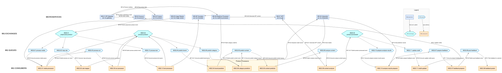

# How Artifica classified products

In 2022, Artifica built models for product categorization, price checks, attribute extraction and brand detection. This case study focuses on categorization in an e-commerce catalog with more than 4,000 categories across six levels.

The classifier combined predictions from product images, titles, descriptions and attributes. It moved from broad categories to more specific ones, deciding at each step which branches to explore and whether the evidence supported a confident result. The system was offered as a SaaS product used by major marketplaces in Türkiye.

## Moving through the category tree

Each category with subcategories had its own trained models. For example, the root models could choose Electronics, then the Electronics models could choose Phones. A category with no subcategories is a leaf, where classification ends.

At each step, the classifier combined model responses using confidence weights. It selected categories whose combined score was at least 40% of the leading score. Exploring a selected category further required models trained for its subcategories.

When classification stopped, the system returned the last confident prediction. The root prediction was always recorded, so a result always existed. If classification stopped at the root and several root categories qualified, the result was flagged as uncertain. The [decision rule](README.md#the-decision-rule) explains the confidence checks and stopping conditions.

## Training data

The team used category-level product counts and frequencies to balance how categories were represented in the training data. This case study is built on a sample dataset taken from the production dataset.

## A sample classification step

Suppose the root has six categories — Electronics, Home & Garden, Fashion, Sports & Outdoors, Toys & Games, and Books & Media. These names illustrate the process.

Four models predict scores for the same six categories, using different product inputs.

| Input | Model method |
| --- | --- |
| Images | Convolutional neural network |
| Title | Neural network |
| Description | Neural network |
| Attributes | Logistic regression |

Separate title and description models let the system use the title when a merchant supplied no description. After combining model outputs into predictions for the current iteration, the classifier decides whether to continue using the flow below.

<p align="center">
  
</p>

A prediction is confident when exactly one of its categories meets the convergence threshold. A category is eligible for another prediction when its score relative to the leader meets the convergence threshold and a working model exists for it. The examples below use a convergence threshold of 0.4.

“Returned predictions” refers to the results being assessed in the current iteration. Each result combines the responses of the models used for that branch. Continuing runs the models for the eligible categories' subcategories, then applies the decision flow again.

### Example: calculating the prediction confidence

The four root models return these scores (%) for one product. Each model's confidence weight is `w = sqrt(top/second - 1)`, using its two highest scores.

| Model | Electronics | Home & Garden | Fashion | Sports & Outdoors | Toys & Games | Books & Media | top / second | Weight `w` |
| --- | --- | --- | --- | --- | --- | --- | --- | --- |
| Images | 50 | 30 | 5 | 5 | 5 | 5 | 50 / 30 = 1.67 | 0.816 |
| Title | 60 | 20 | 5 | 5 | 5 | 5 | 60 / 20 = 3.00 | 1.414 |
| Description | 40 | 35 | 10 | 5 | 5 | 5 | 40 / 35 = 1.14 | 0.378 |
| Attributes | 25 | 45 | 10 | 10 | 5 | 5 | 45 / 25 = 1.80 | 0.894 |

```math
\begin{aligned}
w_{\text{Images}} &= \sqrt{50/30 - 1} = \sqrt{0.667} = 0.816 \\
w_{\text{Title}} &= \sqrt{60/20 - 1} = \sqrt{2.000} = 1.414 \\
w_{\text{Description}} &= \sqrt{40/35 - 1} = \sqrt{0.143} = 0.378 \\
w_{\text{Attributes}} &= \sqrt{45/25 - 1} = \sqrt{0.800} = 0.894 \\
\textstyle\sum w &= 0.816 + 1.414 + 0.378 + 0.894 = 3.502
\end{aligned}
```

The title model separates its top two categories most clearly, so it gets the largest weight. The description model barely separates them, so it contributes least.

Each category's score in the prediction array is the weighted average of the models' scores:

```math
\begin{aligned}
\text{Electronics} &= \frac{0.816 \times 50 + 1.414 \times 60 + 0.378 \times 40 + 0.894 \times 25}{3.502} = 46.6 \\
\text{Home \& Garden} &= \frac{0.816 \times 30 + 1.414 \times 20 + 0.378 \times 35 + 0.894 \times 45}{3.502} = 30.3 \\
\text{Fashion} &= \frac{0.816 \times 5 + 1.414 \times 5 + 0.378 \times 10 + 0.894 \times 10}{3.502} = 6.8 \\
\text{Sports \& Outdoors} &= \frac{0.816 \times 5 + 1.414 \times 5 + 0.378 \times 5 + 0.894 \times 10}{3.502} = 6.3 \\
\text{Toys \& Games} &= \frac{0.816 \times 5 + 1.414 \times 5 + 0.378 \times 5 + 0.894 \times 5}{3.502} = 5.0 \\
\text{Books \& Media} &= \frac{0.816 \times 5 + 1.414 \times 5 + 0.378 \times 5 + 0.894 \times 5}{3.502} = 5.0
\end{aligned}
```

| | Electronics | Home & Garden | Fashion | Sports & Outdoors | Toys & Games | Books & Media |
| --- | --- | --- | --- | --- | --- | --- |
| Prediction array (%) | 46.6 | 30.3 | 6.8 | 6.3 | 5.0 | 5.0 |

The same weight formula is applied to the prediction array, then converted to a confidence:

```math
\begin{aligned}
w &= \sqrt{46.6/30.3 - 1} = \sqrt{0.538} = 0.733 \\
\text{confidence} &= \frac{w}{1 + w} = \frac{0.733}{1.733} = 0.42
\end{aligned}
```

### Example: selecting the next models from the prediction array

The classifier sorts the prediction array and divides each score by the leader's score. It keeps categories while the ratio is at least 0.4, and stops at the first one below it.

| Category | Score (%) | Score / leader | Selected |
| --- | --- | --- | --- |
| Electronics | 46.6 | 1.00 | Yes |
| Home & Garden | 30.3 | 0.65 | Yes |
| Fashion | 6.8 | 0.15 | No, selection stops here |

```math
\begin{aligned}
\text{Electronics} &: \frac{46.6}{46.6} = 1.00 \ge 0.4 \;\Rightarrow\; \text{selected} \\
\text{Home \& Garden} &: \frac{30.3}{46.6} = 0.65 \ge 0.4 \;\Rightarrow\; \text{selected} \\
\text{Fashion} &: \frac{6.8}{46.6} = 0.15 < 0.4 \;\Rightarrow\; \text{not selected, stop}
\end{aligned}
```

Two categories qualify, so this prediction is not confident and both branches are explored. In the next iteration, the Electronics models predict over Electronics' subcategories, and the Home & Garden models predict over Home & Garden's subcategories. A branch is skipped if no trained models exist for its subcategories. Iteration continues only if exactly one of the two new predictions is confident.

Both examples can be reproduced with [`confidence_score.py` and `categories_to_be_explored.py`](README.md#run-the-example).

## Why keep a second branch

The classifier is hierarchical: it combines several models' predictions to choose a category, then the models trained for that category's children predict the next level, and so on. When the top score is not clearly ahead, committing to one branch early risks discarding the right answer. Keeping every plausible branch gives the next level a chance to resolve the ambiguity. The cost is an additional round of predictions from several models for each branch kept.

For a concrete comparison, `categories_to_be_explored.py` also runs two four-category score arrays. Both have a leading score of 55%.

| Category scores (%) | Runner-up relative to leader | Branches selected |
| --- | --- | --- |
| 55, 44, 0.5, 0.5 | 44 / 55 = 0.80 | First and second |
| 55, 15, 15, 15 | 15 / 55 ≈ 0.27 | First only |

In the first case, the runner-up has 80% of the leader's score, so it is close enough to warrant another round of predictions, assuming models are available. In the second, the runner-ups have about 27% of it, so the classifier follows the leader alone, even though the leading score is the same 55%. The top score alone does not determine how much work the classifier does; the gap to the runner-up does. These illustrative scores show how the routing rule behaves. Classification accuracy requires evaluation on labeled products.

## Results on one merchant catalog

One merchant's home-textile and furniture catalog was classified in 2023. The merchant label is not ground truth here: the merchant used the system because their existing categorization needed correction, so the figures below measure how much of the catalog the system proposed to change, not an error rate. All numbers cover only products that scored at least 0.9 confidence.

Of the 37,139 such products that already had a merchant category (another 864 had none and received one):

| System output vs. merchant category | Products | Share of 37,139 |
| --- | ---: | ---: |
| Same category kept | 1,600 | 4.3% |
| More specific category, same branch | 11,160 | 30.0% |
| More general category, same branch | 3,195 | 8.6% |
| Different branch | 21,184 | 57.0% |

The merchant's team reviewed a random sample of 910 proposals item by item and applied 803 of them to their catalog; rejected proposals kept their original category.

| Proposal type | Reviewed | Applied | Rate |
| --- | ---: | ---: | ---: |
| Category for previously uncategorized product | 60 | 58 | 96.7% |
| More specific category, same branch | 220 | 206 | 93.6% |
| Different branch | 550 | 506 | 92.0% |
| More general category, same branch | 80 | 33 | 41.3% |
| **Total** | **910** | **803** | **88.2%** |

The merchant applied 88% of the sampled proposals, including 92% of the moves to a different branch — the proposal type that dominated the output. The clear exception is proposals to broaden a category, which were mostly declined (33/80). Note that the application rate is not a blind accuracy measurement: the merchant decided while seeing each proposal.

## Platform architecture

The classifier ran inside Artifica's AI-Commerce platform. The diagram below shows the analysis pipeline — microservices, MQ exchanges and queues, and MQ consumers — from product ingestion through preprocessing and prediction to customer feedback ([Graphviz source](assets/analysis-pipeline.dot)). The category classifier described in this case study lives in the `MQC.06 category-predictor` worker, with `MS.04 Interpreter` combining model responses and persisting prediction results. Every `MS.*` microservice runs behind its own load balancer, and `MS.07 GPT` runs on an Azure instance. Solid arrows are direct calls and publishes; dashed arrows are message-queue deliveries. `WF.nn` labels are numbered workflow steps.

<p align="center">
  
</p>
