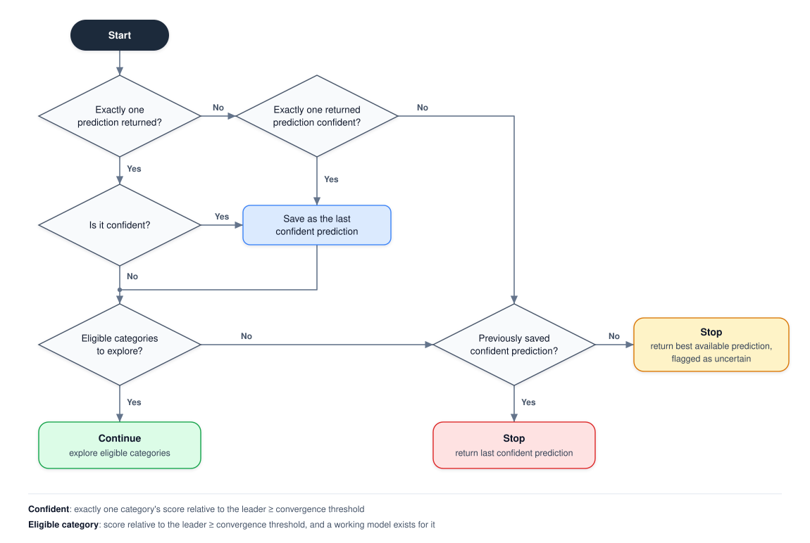

# How Artifica classified products

Artifica built models for product categorization, price checks, attribute extraction and brand detection. This case study focuses on categorization in an e-commerce catalog with more than 4,000 categories across six levels.

The classifier combined predictions from product images, titles, descriptions and attributes. It moved from broad categories to more specific ones, deciding at each step which branches to explore and whether the evidence supported a confident result. The system was offered as a SaaS product used by major marketplaces in Türkiye.

## Moving through the category tree

Each category with subcategories had its own trained models. For example, the root models could choose Electronics, then the Electronics models could choose Phones. A category with no subcategories is a leaf, where classification ends.

At each step, the classifier combined model responses using confidence weights. It selected categories whose combined score was at least 40% of the leading score. Exploring a selected category further required models trained for its subcategories.

When classification stopped, the system returned the last confident prediction. The root prediction was always recorded, so a result always existed. If classification stopped at the root and several root categories qualified, the result was flagged as uncertain. The [decision rule](README.md#the-decision-rule) explains the confidence checks and stopping conditions.

## A sample classification step

Suppose the root has six categories — Electronics, Home & Garden, Fashion, Sports & Outdoors, Toys & Games, and Books & Media. These names illustrate the process.

Four models predict scores for the same six categories, using different product inputs.

| Input | Model method |
| --- | --- |
| Images | Convolutional neural network |
| Title | Neural network |
| Description | Neural network |
| Attributes | Logistic regression |

Separate title and description models let the system use the title when a merchant supplied no description. After combining model outputs into predictions for the current iteration, the classifier decides whether to continue using the flow below.

  

A prediction is confident when exactly one of its categories meets the convergence threshold. A category is eligible for another prediction when its score relative to the leader meets the convergence threshold and a working model exists for it. The examples below use a convergence threshold of 0.4.

“Returned predictions” refers to the results being assessed in the current iteration. Each result combines the responses of the models used for that branch. Continuing runs the models for the eligible categories' subcategories, then applies the decision flow again.

For a concrete comparison, the [runnable example](README.md#run-the-example) uses four-category score arrays. Both have a leading score of 55%.

| Category scores (%) | Runner-up relative to leader | Branches selected |
| --- | --- | --- |
| 55, 44, 0.5, 0.5 | 44 / 55 = 0.80 | First and second |
| 55, 15, 15, 15 | 15 / 55 ≈ 0.27 | First only |

In the first case, the second category is close enough to warrant another round of predictions, assuming models are available. In the second, only the leading category qualifies. These illustrative scores show how the routing rule behaves. Classification accuracy requires evaluation on labeled products.
